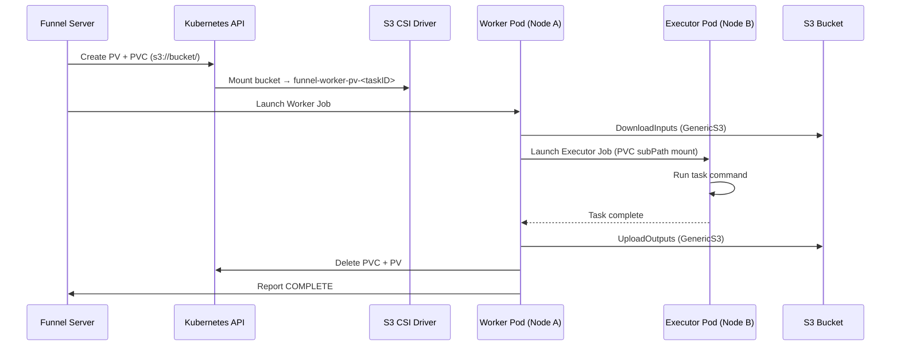

> **Warning:** Funnel on Kubernetes is in active development and may involve frequent updates 🚧

# Kubernetes

## 1. Add Helm Repo

> **Note:** See Funnel's [Helm Charts](https://github.com/calypr/helm-charts/tree/main/charts/funnel) for the latest configuration options

```sh
helm repo add calypr https://calypr.org/helm-charts

helm repo update calypr

helm search repo calypr/funnel
```

## 2. Deploy Funnel

```sh
helm upgrade --install funnel calypr/funnel

kubectl rollout status deployment/funnel-server

kubectl get deployments
# NAME           READY   STATUS
# funnel-server   1/1     Running
```

## 4. Port-Forward for Local Access

```sh
kubectl port-forward svc/funnel 8000:8000

funnel task list
# {}
```

## 4. Submit Example Task

```sh
funnel examples hello-world > hello-world.json

funnel task create hello-world.json
# <Task ID>

funnel task get <Task ID> --view MINIMAL
# { "id": "...", "state": "COMPLETE" }
```

# Storage Architecture

The following diagram shows the legacy per-task S3 volume flow. For native storage bindings and other volume options, see the [Kubernetes storage guide](../kubernetes-storage/).

Funnel uses the [AWS S3 CSI Driver](https://github.com/awslabs/mountpoint-s3-csi-driver) to provision a per-task PersistentVolume (PV) and PersistentVolumeClaim (PVC) backed by S3. This gives Worker and Executor pods `ReadWriteMany` access across nodes without requiring them to co-schedule.



# Startup cleanup

When the internal reconciler is enabled, backlog cleanup runs in the background
so Kubernetes cleanup does not delay server startup. Periodic reconciliation
starts after that cleanup finishes; the two operations do not run concurrently.
Cleanup uses the server context, so stopping the server cancels in-flight cleanup
requests.

`Kubernetes.DisableJobCleanup` skips backlog cleanup while keeping reconciliation
enabled. `Kubernetes.DisableReconciler` disables both automatic startup cleanup
and periodic reconciliation.

# Executor image pull policy

Executor containers use `Always` by default. Set the task tag `_IMAGE_PULL_POLICY`
to `Always`, `IfNotPresent`, or `Never` to override the policy for that task:

```json
"tags": {
  "_IMAGE_PULL_POLICY": "IfNotPresent"
}
```

An absent or empty tag keeps the default. Invalid values fail executor setup.
The tag applies to executor containers; it does not change the worker image's
pull policy. Custom executor templates must use `{{.ImagePullPolicy}}` in their
`imagePullPolicy` field to honor the tag.

# Additional Resources 📚

- [Helm Repo](https://calypr.org/helm-charts)
- [Helm Repo Source](https://github.com/calypr/helm-charts)
- [Helm Chart values reference](https://github.com/calypr/helm-charts/tree/main/charts/funnel)
- [AWS S3 CSI Driver](https://github.com/awslabs/mountpoint-s3-csi-driver)
- [The Chart Best Practices Guide](https://helm.sh/docs/chart_best_practices/)
- [GitHub issue #1412 — S3 Working Directory Behavior](https://github.com/calypr/funnel/issues/1412)
